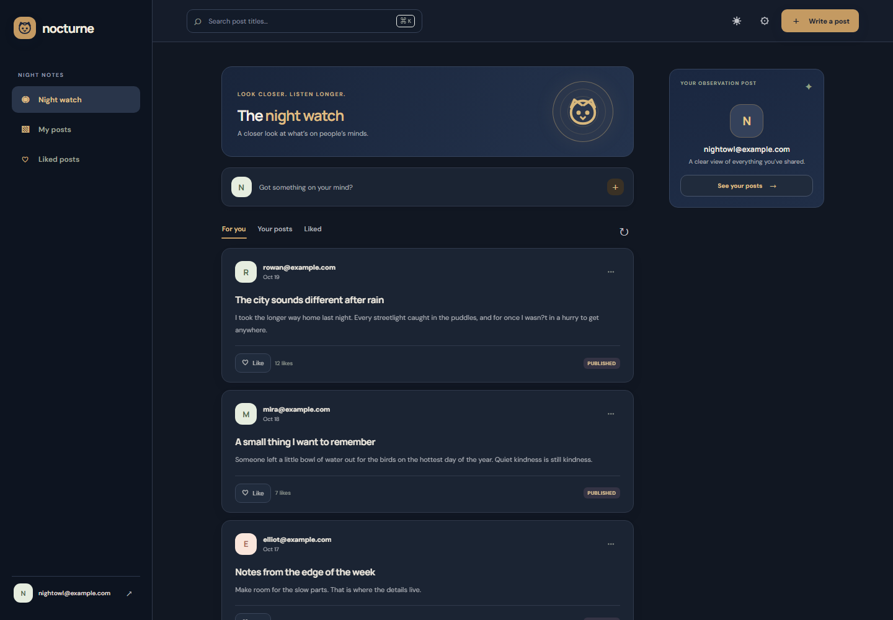

# Nocturne

Nocturne is a small social space for sharing thoughts and finding interesting ideas. The FastAPI backend serves the responsive web app directly, so you can run both with one command.

## Screenshots

| Sign in | Community feed |
| --- | --- |
|  |  |

| Dark mode |
| --- |
|  |

The feed screenshots use sample preview data.

## Run it in two steps

Before starting, make sure Python dependencies are installed, PostgreSQL is running, and the root `.env` file contains the database and authentication settings used by `app/config.py`.

1. From the repository root, start the app:

   ```powershell
   .\.venv\Scripts\python.exe -m uvicorn app.main:app --reload
   ```

2. Open **http://127.0.0.1:8000** in your browser. The interactive API docs are at **http://127.0.0.1:8000/docs**.

## What you can do

- Create an account and sign in with JWT authentication.
- Browse and search the community feed.
- Write, edit, and delete your own posts.
- Like posts and revisit them in **Liked posts**.
- Switch between light and dark themes; your theme choice is saved in the browser.
- Use the responsive interface on desktop and mobile.

## Project structure

```text
app/
  main.py             FastAPI app and frontend hosting
  models.py           SQLAlchemy models
  schemas.py          Request and response schemas
  routers/
    auth.py           Login and token creation
    post.py           Post feed and CRUD endpoints
    user.py           User registration and profile endpoint
    vote.py           Voting and liked-post endpoints
frontend/
  index.html          Nocturne pages and app structure
  app.js              Frontend behavior and API integration
  styles.css          Responsive light and dark themes
tests/                API tests
```

## Tech

FastAPI, PostgreSQL, SQLAlchemy, Pydantic, Alembic, JWT authentication, and plain HTML/CSS/JavaScript.
